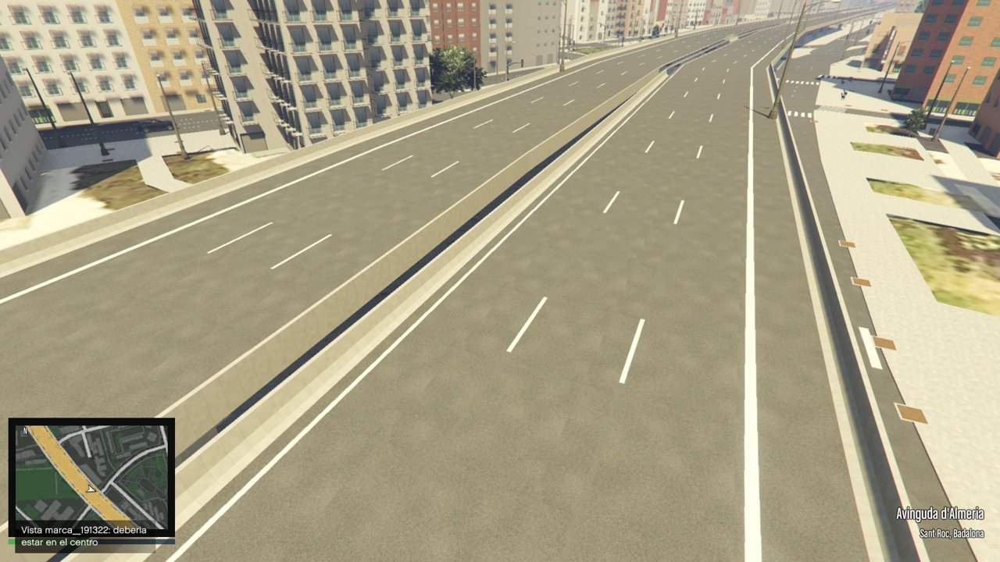
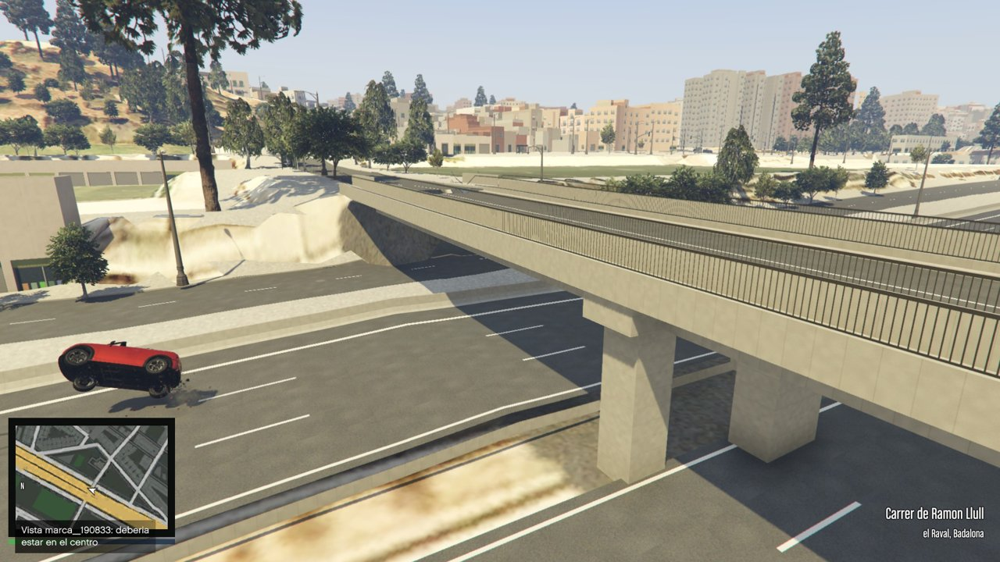
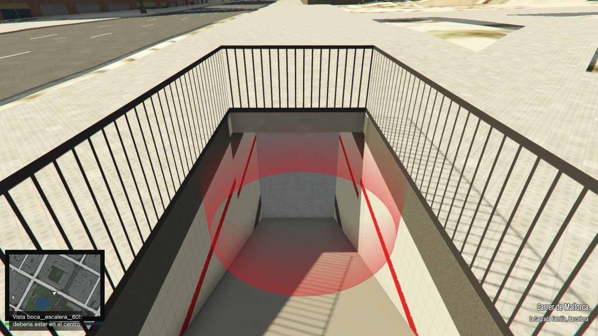
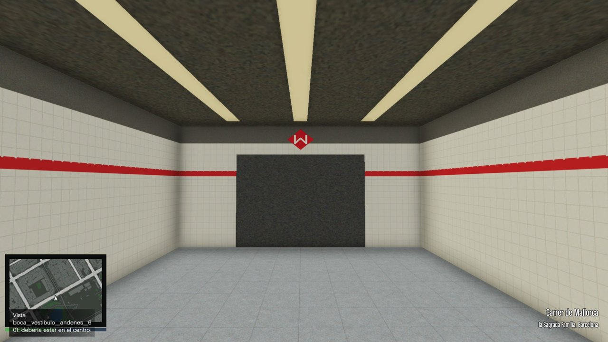

# Barcelona en GTA V

Un mapa de Barcelona, Badalona, Sant Adrià de Besòs y Santa Coloma de Gramenet para **GTA V Legacy (PC, modo historia)**, generado a partir de datos públicos:
- relieve LiDAR;
- ortofotos;
- edificios del Catastro;
- calles de OpenStreetMap.

Sustituye a Los Santos: el juego arranca directamente en Barcelona, en un modo libre (sandbox).

Este repositorio contiene **solo las herramientas** que generan el mapa. No contiene archivos de Rockstar ni el mapa ya generado, que ocupa unos 15 GB y se puede rehacer.

**Proyecto aparcado el 2026-11-04.** En qué estado queda y qué faltaba está en [`ESTADO.md`](ESTADO.md).

| | |
|---|---|
|  |  |
| Viaducto de la C-31 en Sant Roc (Badalona) | Puente sobre la Autopista del Maresme (el Raval, Badalona) |
|  |  |
| Boca de metro en el carrer de Mallorca (Sagrada Família) | El vestíbulo al bajar la escalera |

## Qué hace cada parte

| Herramienta | Qué hace |
|---|---|
| `herramientas_v/prototipo.py` | Genera una hoja de 1 km²: terreno, calles, aceras, muros, ortofoto. |
| `edificios_v.py`, `fachadas_v.py`, `catastro.py` | Edificios con su altura y fachadas a partir del Catastro. |
| `calles_v.py`, `puentes_v.py`, `tuneles_v.py` | Calzadas, arcenes, puentes y túneles a partir de OSM. |
| `mobiliario_v.py` | Árboles y mobiliario urbano. |
| `costa_v.py`, `rios_v.py`, `quitar_ls.py` | Mar, río Besòs y la retirada de Los Santos (en `mods/update/update.rpf`). |
| `trafico_v.py` | Caminos de coches (`.ynd`) para el tráfico. |
| `radar_v.py`, `mapa_pausa_v.py` | Plano del radar y del mapa del menú de pausa. |
| `empaquetar_v.py` | Convierte todo a formato del juego y monta los paquetes DLC (`bcn`, `bcn2`, …). |
| `versiones_v.py` | Guarda y restaura versiones de los paquetes instalados. |
| `config_v.py` | Rutas, coordenadas y la lista de hojas. |
| `diag/*.c` | Plugins de ScriptHookV: radar y mapa (`bcn_radar`), modo libre (`bcn_sandbox`) y diagnóstico (`bcn_diag`). |
| `cwtool/` | Pequeña herramienta en C# sobre CodeWalker.Core para leer y escribir RPF, XML y recursos del juego. |

Coordenadas: juego = UTM 31N (ETRS89) − (430500, 4585000). Una hoja es un cuadrado de 1 km llamado por su esquina (EEENNN, en km).

## Requisitos

- GTA V Legacy original (Steam, Epic o Rockstar), con la carpeta `mods` (OpenIV / ASI Loader).
- [ScriptHookV](http://www.dev-c.com/gtav/scripthookv/) para los plugins.
- Python 3.12 con numpy, scipy, shapely, pillow, pyproj y osmium (las herramientas de `blender/` usan Blender).
- .NET 8 SDK y CodeWalker.Core para `cwtool`.
- zig (como compilador de C) para los plugins: `zig cc -target x86_64-windows-gnu -shared -O2 -o bcn_radar.asi bcn_radar.c -luser32`.
- Unos 100 GB libres si se genera todo el mapa (cada hoja ocupa ~0,5 GB entre datos y resultado).

## Uso básico

```sh
cd herramientas_v
python prototipo.py 431583          # genera una hoja
python empaquetar_v.py --cambiadas  # empaqueta e instala las hojas cambiadas (con el juego cerrado)
python radar_v.py                   # radar, plano y tráfico
python quitar_ls.py                 # quita Los Santos (deshacer: --deshacer)
```

Copia los `.asi` compilados de `diag/` en la carpeta del juego.

## Fuentes de datos y licencias

Los datos no van en el repositorio. Se descargan y hay que citarlos al publicar:
- **Institut Cartogràfic i Geològic de Catalunya (ICGC)**: LiDAR, ortofotos y modelo del terreno, con licencia CC BY 4.0.
- **Dirección General del Catastro**: edificios. Se pueden reutilizar citando la fuente.
- **OpenStreetMap**: calles, parques y agua. © colaboradores de OpenStreetMap, con licencia ODbL.
- **Mapillary**, opcional, para las fachadas. Necesita un token propio en `datos/mapillary_token.txt`, que nunca se sube.

GTA V y sus archivos son de Rockstar Games. Este proyecto no incluye ninguno y solo funciona en modo historia. No lo uses en GTA Online.

## Cómo colaborar

1. Abre un *issue* con el fallo o la idea. Si es un fallo del mapa, añade una captura y las coordenadas: la tecla F9 las guarda en `bcn_marcas.txt`.
2. Trabaja en una rama propia y abre un *pull request*.
3. Para probar un cambio basta con regenerar y empaquetar las hojas afectadas. No hace falta el mapa entero.
4. Antes de abrir el *pull request*, pasa `python herramientas_v/comprobar_v.py` (y `--a-fondo` con las hojas que hayas tocado) y pega el resultado. Si avisa de que tus datos no son los de `VERSIONES_DATOS.json`, dilo también.
   
UPDATE: Lo he hecho publico para todos, si alguien quiere ayudar en lo que sea, pista libre. Buena suerte.
